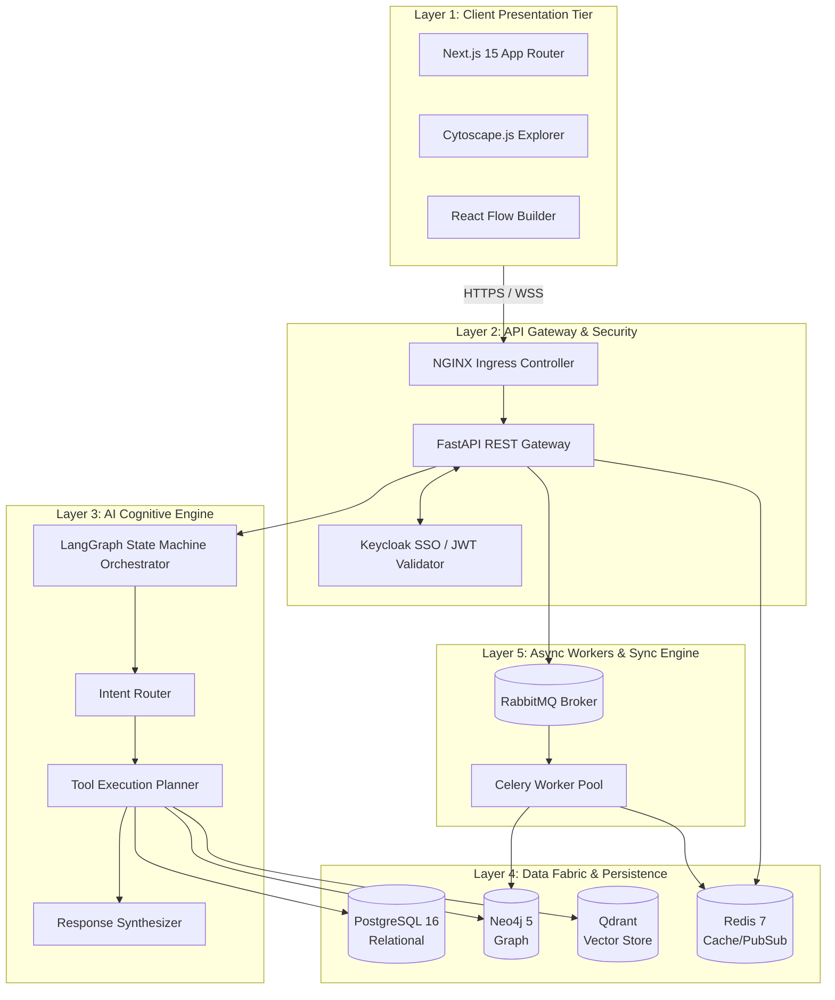
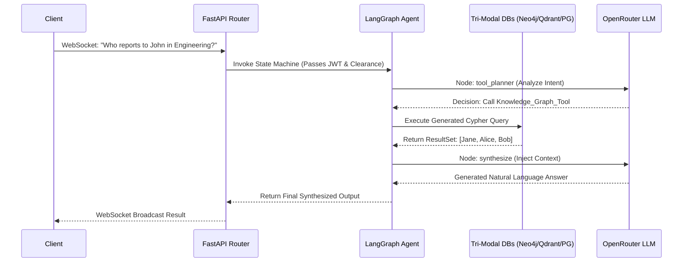

# SentinelOS AI: Enterprise Digital Twin Operating System

SentinelOS AI is an enterprise-grade **Digital Twin Operating System** that constructs a real-time, queryable, AI-native replica of an organization's entire operational fabric — its people, processes, projects, customers, financial instruments, and institutional knowledge. 

Unlike traditional business intelligence platforms that provide retrospective analytics on static data exports, SentinelOS maintains a living, breathing digital mirror that evolves in real-time as the organization changes.

---

## 📑 Table of Contents
1. [Vision and Value Proposition](#-vision-and-value-proposition)
2. [Key Features](#-key-features)
3. [System Architecture & Data Flows](#-system-architecture--data-flows)
   - [High-Level System Topology](#high-level-system-topology)
   - [AI Cognitive Query Data Flow](#ai-cognitive-query-data-flow)
   - [RAG Document Ingestion Pipeline](#rag-document-ingestion-pipeline)
4. [Component Architecture Detail](#-component-architecture-detail)
5. [Technology Stack](#-technology-stack)
6. [Project Structure](#-project-structure)
7. [Comprehensive Getting Started Guide](#-comprehensive-getting-started-guide)
8. [Testing & Quality Assurance](#-testing--quality-assurance)
9. [License & Confidentiality](#-license--confidentiality)

---

## 🎯 Vision and Value Proposition

The platform addresses a fundamental problem facing modern enterprises: **organizational opacity at scale**. Decision-makers lose visibility into the complex interdependencies between teams, projects, customers, and resources. 

SentinelOS answers complex questions like: *"If we reallocate Engineer X from Project A to Project B, what is the cascading impact on delivery timelines, customer SLAs, and department budgets?"* by utilizing a tri-modal data fabric, allowing you to converse with your organization.

---

## 🌟 Key Features

- **Tri-Modal Data Fabric:**
  - **Relational Ground Truth (PostgreSQL 16):** ACID-compliant transactional layer handling standard entity creation (employees, departments, projects, tickets).
  - **Knowledge Graph (Neo4j 5):** Relationship-first mapping that captures non-linear dependencies (reporting structures, task dependencies).
  - **Semantic Memory (Qdrant):** An AI-native vector store indexing unstructured institutional knowledge via dense embeddings.
- **AI Cognitive Layer:** Uses **LangGraph** multi-agent orchestration for intent routing, tool-augmented reasoning, and natural language synthesis.
- **Real-Time Graph Synchronization:** Event-driven replication (CQRS pattern) from PostgreSQL to Neo4j via **Celery** workers and **RabbitMQ**.
- **Hybrid RAG Pipeline:** Document ingestion with layout-aware parsing using **PyMuPDF** and **PaddleOCR**, followed by semantic chunking.
- **Enterprise Security Model:** Integrating **Keycloak SSO**, strictly enforced JWT validation, Row-Level Security, and a 5-level security clearance hierarchy.
- **Interactive Process & Graph Visualizations:** Featuring **Cytoscape.js** for graph exploration, and **React Flow** for process automation building on a **Next.js 15** application shell.

---

## 🏗️ System Architecture & Data Flows

### High-Level System Topology

SentinelOS is constructed as a modular monolith spanning 5 architectural layers.



### AI Cognitive Query Data Flow

When a user asks a complex question, the AI autonomously determines the optimal database tool to invoke.



### RAG Document Ingestion Pipeline

Unstructured documents are parsed asynchronously to build semantic memory.

```mermaid
graph LR
    A[Client Uploads PDF] -->|REST API| B[FastAPI Endpoint]
    B -->|Celery Dispatch| C(Async Parsing Task)
    C --> D{Text Legibility Check}
    D -->|Digital Text| E[PyMuPDF Extraction]
    D -->|Scanned / Images| F[PaddleOCR Layout Analysis]
    E --> G[Markdown Buffer Compilation]
    F --> G
    G --> H[Semantic Chunking]
    H --> I[Embedding Generation (text-embed-3)]
    I --> J[(Qdrant Vector Upsert)]
```

---

## 🧩 Component Architecture Detail

### 1. Client Presentation Tier (Frontend)
- Built on **Next.js 15 App Router** running on Node.js 20.
- Implements an optimistic UI with real-time websocket integrations for immediate feedback.
- Uses **Cytoscape.js** for interactive organizational graph visualizations and **React Flow** for process/workflow builders.

### 2. API Gateway & Security (Backend)
- Powered by **FastAPI** on Python 3.12, running highly concurrent async workloads via `uvicorn`.
- Connects securely to an external **Keycloak SSO** instance for OIDC and stateless RS256 JWT validation.
- Employs strict Row-Level Security (RLS) constraints mapped to a hierarchical 5-level security clearance.

### 3. AI Cognitive Engine
- **LangGraph** orchestrates the complex multi-agent flows.
- Features dynamic intents that intelligently dispatch requests to SQL agents, Cypher graph agents, or Vector search agents depending on query semantics.
- Utilizes the **OpenRouter API** to leverage state-of-the-art models (OpenAI GPT-4, Google Gemini, Anthropic Claude).

### 4. Tri-Modal Data Fabric
- **PostgreSQL (v16):** Accessed asynchronously via `asyncpg` and SQLAlchemy 2.0 ORM.
- **Neo4j (v5):** Contains 5 Core Node types and 6 Edge types representing the entity-relationship map.
- **Qdrant:** Houses 1536-dimensional vectors mapping organizational manuals and unstructured metadata.
- **Redis (v7):** Implements distributed caching and acts as the Pub/Sub spine for WebSocket broadcasts.

### 5. Async Workers & Sync Engine
- **Celery:** Implements CQRS (Command Query Responsibility Segregation) by capturing relational mutations and reliably piping them into the graph database.
- Implements idempotent `MERGE` actions, deadlock prevention, and exponential backoff retry policies.

---

## 🛠️ Technology Stack

| Domain | Technology / Framework | Version / Notes |
|---|---|---|
| **API & Backend** | Python, FastAPI, Pydantic v2 | Python 3.12, Uvicorn, async routing |
| **Relational ORM** | SQLAlchemy, Alembic, asyncpg | v2.0 Declarative mapping, Migrations |
| **AI / NLP** | LangGraph, PydanticAI, OpenAI/Cohere | OpenRouter Gateway |
| **Graph DB** | Neo4j Enterprise | v5.18 |
| **Vector DB** | Qdrant | v1.8, 1536-dim embeddings |
| **Caching & Message** | Redis, RabbitMQ, Celery | Event Brokers & Task Queues |
| **Document Processing**| PyMuPDF, PaddleOCR, Docling | Layout-aware document parsing |
| **Frontend UI** | Next.js, React, Tailwind CSS | App Router layout, Server Components |
| **Visualizations** | Cytoscape.js, React Flow, ECharts | Dashboards & Sandbox modeling |
| **Observability** | Prometheus, Grafana, OpenTelemetry | Sentry Crash Reporting |
| **DevOps** | Docker, Kubernetes, GitHub Actions | Blue-Green Deployments |

---

## 📂 Project Structure

```text
sentinelos-ai/
├── agents/             # LangGraph State Machines & Agentic Tool Registries
├── backend/            # FastAPI API Services, Routes & Auth Middleware
├── digital_twin/       # Graph Sync Engine, Celery Workers, Risk Analysis
├── docker/             # Docker Compose cluster configuration & local infra
├── frontend/           # Next.js 15 Application Shell & UI Components
├── rag/                # Vector Ingestion, Layout Parsers, Semantic Splitters
├── scripts/            # Database bootstraps & host automation
├── shared/             # Shared Pydantic schemas (Cross-module validation)
└── tests/              # Pytest Unit, Integration, and E2E Suites
```

---

## 🚀 Comprehensive Getting Started Guide

### Prerequisites
- [Docker Engine & Docker Compose](https://www.docker.com/) installed and running.
- Python 3.12+ for localized API execution.
- Node.js 20+ for the frontend client.
- Git.

### 1. Repository Setup & Environment
Clone the repository and prepare the configurations:
```bash
git clone https://github.com/organization/sentinelos-ai.git
cd sentinelos-ai

# Copy the example environment template
cp .env.example .env
```
*Note: Ensure you open `.env` and configure your `OPENAI_API_KEY`, `KEYCLOAK_REALM_URL`, and local database passwords before proceeding.*

### 2. Infrastructure Initialization (Docker)
We use Docker Compose to spin up the local backing services (PostgreSQL, Neo4j, Qdrant, Redis, RabbitMQ):
```bash
cd docker
docker-compose up -d

# Verify all services are healthy
docker-compose ps
```

### 3. Database Bootstrapping
Run the script to initialize SQLAlchemy migrations via Alembic. This will build the exact relational tables required by the system:
```bash
# Return to project root
cd ..

# Execute bootstrap shell script
bash scripts/bootstrap_databases.sh
```

### 4. Running the API Gateway (Backend)
The FastAPI server handles REST requests and WebSocket connections.
```bash
cd backend

# Create and activate a Python virtual environment
python -m venv venv
source venv/bin/activate  # On Windows use: venv\Scripts\activate

# Install dependencies
pip install -r ../requirements.txt

# Start the uvicorn development server on port 8000
uvicorn app.main:app --host 0.0.0.0 --port 8000 --reload
```

### 5. Running the Asynchronous Workers
The Celery workers must run in a separate terminal process to synchronize the Digital Twin graph state.
```bash
# In a NEW terminal window:
cd digital_twin

# Activate the same virtual environment
source ../backend/venv/bin/activate

# Launch the Celery worker pool
celery -A app.celery_app worker --loglevel=info -Q graph_sync_queue,risk_analysis_queue -c 4
```

### 6. Starting the Frontend Presentation Tier
Launch the Next.js application.
```bash
# In a NEW terminal window:
cd frontend

# Install Node dependencies
npm install

# Start the development server on port 3000
npm run dev
```
Navigate to `http://localhost:3000` to access the SentinelOS dashboard.

---

## 🧪 Testing & Quality Assurance

SentinelOS enforces rigorous automated testing for enterprise stability.

```bash
# Activate your python virtual environment
source backend/venv/bin/activate

# Run standard test suite
pytest tests/

# Run tests with coverage reporting
pytest tests/ --cov=backend --cov=agents --cov=digital_twin

# Run only e2e integration workflows
pytest tests/e2e/
```

---

## 📄 License & Confidentiality

**Classification: Strictly Confidential / Proprietary**

This software, repository, and corresponding documentation contain proprietary and confidential technical specifications belonging to **SentinelOS AI GmbH**. Unauthorized reproduction, distribution, reverse engineering, or disclosure of any material contained herein is strictly prohibited under applicable trade secret and intellectual property laws.

**© 2026 SentinelOS AI GmbH. All Rights Reserved.**
